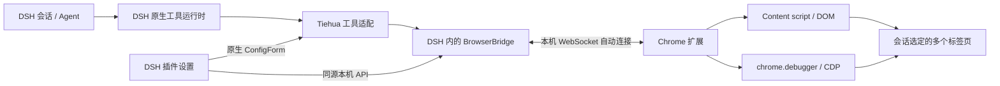

# 架构与开发约定

## 原生集成

DSH 通过 `ctx.tools.register` 注册工具，沿用自己的工具执行、输出和取消接口。截图通过 `ctx.attachments.saveImage` 写入原生附件服务。插件对外提供 `ctx.tiehuaBrowser`，后续工作台插件可以在有明确会话身份的上下文中调用 `bridge.call`。

可热更新的配置是 Cordis `Volatile<T>` 引用，必须在操作时通过 `.get()` 读取。`loader/volatile-update` 触发连接管理器重配置；禁用、切换端口和卸载会关闭对应 WebSocket 服务。`dataDir` 为普通配置，由宿主重新加载插件生效。

客户端由 DSH `window.__ModuleLoader__` 加载，向 `settings.plugins.tab` 注册设置页。配置通过原生 ConfigForm 保存；本机 HTTP API 只提供状态与释放/恢复操作，不提供通用网页执行接口。

设置 API 同时依赖 `webServer` 与 `connection`，每次请求均通过 DSH 的 `connection.admit()` 验证已签名的会话 Cookie。DSH 桌面端从 `dsh-app://app` 转发时会移除 `Origin` 和 `Sec-Fetch-Site`，因此允许这些头缺省，但仍要求回环地址、本机 Host、`x-tiehua-ui: 1` 与有效的 DSH 认证。显式跨站来源继续拒绝，不需要修改 DSH 桌面端代码。

## 代码布局

| 文件 | 职责 |
|---|---|
| `src/index.ts` | 原生插件 schema、生命周期、服务与工具注册 |
| `src/bridge.ts` | 本机来源校验、浏览器实例、会话路由、排队、超时和取消 |
| `src/tools.ts` | 23 个原生工具、参数校验、附件与本地文件适配 |
| `src/routes.ts` | 同源本机设置 API |
| `src/client/index.tsx` | 原生插件设置页 |
| `src/vendor/` | 上游工具 metadata、分页与脚本校验逻辑，无 MCP 运行时 |
| `extension/` | Chrome MV3 扩展、DOM/CDP 执行器与连接弹窗 |
| `scripts/adapt-upstream.mjs` | 从固定上游源码重现适配改动 |
| `scripts/build.mjs` | 构建宿主 ESM 与 DSH 客户端模块 |
| `scripts/smoke-build.mjs` | 编译产物集成检查 |

## 标签页和会话

服务端会话身份来自 `ToolRunContext.agent.session.header.id`，发送时加 `tiehua:` 前缀；模型参数不能伪造该身份。会话默认关联一个浏览器实例，实例中可以使用多个标签页。

扩展分别保存默认页与所有权集合。显式 `tabId` 操作会登记页面，`select`/`new` 还会更新默认页；Chrome 当前前台页不参与目标选择。归属集合不会在第 17 页时遗忘旧页面，关闭页面会清理对应记录。

跨会话冲突在执行页面命令前检查。释放通过有回执的扩展命令清理本地所有权和默认页，再移除宿主会话绑定，防止原会话恢复时重新占用已经释放的页面。

同一浏览器实例的命令串行执行，不同实例可以独立执行。`browserId` 明确切换实例；已有绑定离线时返回错误，不自动转到其他实例。

## 失败语义

- 握手前拒绝工具消息；仅接受回环连接、本机 Host 和有效 Chrome 扩展 Origin。握手中的扩展 ID 必须与 Origin 一致。无需配对码，旧配对字段被忽略；这一模式信任本机进程和已安装扩展，不是远程认证机制。
- 每条调用使用独立关联 ID，其他浏览器实例的响应不会结束该调用。
- 原生传输层不自动重试已发出的页面操作。连接断开、超时、取消均需要区分“未发送”和“可能已执行”。
- 不确定状态允许读取快照、正文、查询、截图和标签页列表，阻止新的修改操作。迟到的有效回执可解除对应不确定状态；用户也可以在核实页面后解除。
- `network` 可能刷新页面，因此不列入不确定状态下的只读工具。
- 取消消息会阻止尚未开始的批处理步骤，并尝试取消等待用户的页面面板。已发出的单步浏览器动作无法撤销。

## 下一步联调

1. 在 DSH 0.2.1-rc.3 的真实桌面 profile 中安装 tgz，验证设置页加载、热更新开关和错误显示。
2. 在用户选择的 Chrome 中加载扩展，验证自动连接与断线重连。
3. 用两个测试页面完成列页、选页、读文、填表、截图，再用第二个 DSH 会话验证隔离和释放。
4. 通过后再验证 BI 与公众号站点。Canvas 图表、跨域 iframe、富文本编辑器、上传下载分别确认，不以普通 DOM 测试替代。
5. 后续工作台在原生服务上编排素材收集、知识库、写作、配图、排版与草稿投递。
